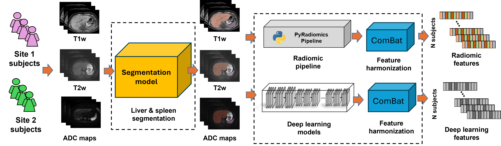

## An automatic feature extraction pipeline for multi-center, multiparametric MRI data.

We developed an automated pipeline to extract and harmonize features from multi-center, multiparametric MRI data, including T1-weighted (T1w), T2-weighted (T2w), and Diffusion-Weighted Imaging (DWI) sequences. 

To ensure precise localization across modalities, 3D segmentation of the liver and spleen was performed using our deep learning framework. For the diffusion track, the b0 images were prioritized for segmentation due to their high signal-to-noise ratio and structural similarity to T2-weighted images; the resulting masks were then registered and applied to the corresponding Apparent Diffusion Coefficient (ADC) maps calculated from the full DWI acquisition. Following segmentation, we utilized a dual-track feature extraction approach. For the radiomics track, we utilized a standardized extraction engine (e.g., PyRadiomics) to generate 3D feature vectors from the segmented volumes of both organs across all three modalities (T1w, T2w, and ADC). For the deep learning track, we employed deep learning architecture (e.g., ResNet or Vision Transformer [ViT]). To adapt the 3D volumes for the input, segmented 2D slices were processed sequentially, and the resulting slice-level embeddings were aggregated into a single subject-level vector via global average pooling. This process yielded six distinct feature vectors per subject, representing two organs across three imaging modalities, which were subsequently concatenated into a unified, high-dimensional feature profile. To mitigate "batch effects" and scanner-induced variance across clinical sites, we applied ComBat harmonization to the final concatenated vectors, ensuring a standardized feature space for downstream multi-center analysis.
